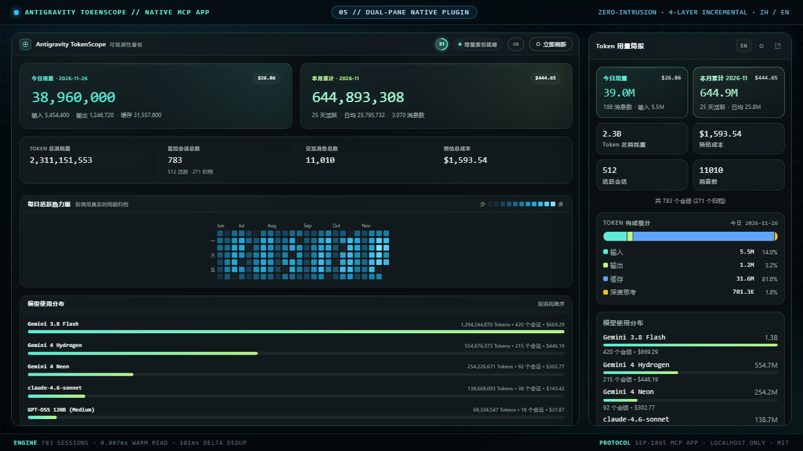

<div align="center">


# Antigravity TokenScope

**Native Token & Cost Observability Inside Antigravity — Zero Double-Counting, Zero Cloud Upload, No VS Code Required.**

[](https://antigravity.google/)
[](https://github.com/modelcontextprotocol/ext-apps)
[](https://svelte.dev/)
[](#-privacy--disclaimer)
[](LICENSE)

**English** | [简体中文](docs/README.zh-CN.md)

</div>

---



## Why Antigravity TokenScope?

Ever wondered how many tokens your Antigravity agents actually consumed **today** or **this month**—without switching editors, without 2x–5x subagent inflation, and without sending a single byte of your prompts to third-party servers?

**Antigravity TokenScope** runs natively inside Antigravity as an **MCP App Plugin** (while keeping the original VS Code extension in maintenance mode), turning raw session logs, SQLite databases, and localhost RPC metadata into an exact, real-time cost & usage observatory.

| Dimension | Antigravity TokenScope | Traditional External / Naive Counters |
| :--- | :--- | :--- |
| **Native Workflow** | Built right into Antigravity's left sidebar (`global`), right aux pane (`aux_pane`), and chat | Requires switching to VS Code or running manual terminal scripts |
| **Accounting Accuracy** | Orthogonal Thinking/Output split, cross-session `responseId` arbitration, reverted-branch fusion | Double-counts reasoning tokens, retries, and cloned subagent history (2x–5x inflated) |
| **Daily & Monthly Insights** | Hero **Monthly Cumulative** KPI, **Today's Exact Breakdown**, true local-date daily heatmap & cost | Mixes multi-day sessions into the latest day or averages historical prices |
| **Speed & Resilience** | Non-blocking `< 200ms` warm boot, native `node:sqlite` `.db` reader, 50 MB large-session support | Blocks UI on cold scans or truncates long sessions |
| **Privacy** | 100% local parsing & `127.0.0.1` loopback-only RPC; zero telemetry | Often requires external proxies or cloud sync |

---

## Three Native Entry Points Inside Antigravity

1. **Left Sidebar Global Dashboard (`TokenScope`)**
   Full-page Svelte 5 observatory featuring **Monthly Cumulative Usage**, **Today's Token Breakdown** (Input / Output / Cache / Reasoning), interactive **Daily Activity Heatmap**, **Model Usage & LiteLLM Cost**, **Data Accuracy Coverage**, and **Session Leaderboard**—auto-adapting to Antigravity Light & Dark themes.
2. **Right Auxiliary Pane (`Token 用量`)**
   Open from the side pane `+` menu for a persistent compact companion card highlighting **This Month's Total**, **Today's Consumption**, and **Today's Token Mix** while you chat.
3. **Conversational Queries (Bundled Skill)**
   Ask `"How many tokens did I spend this month?"` or `"今天用了多少 token"` right in chat—the bundled `token-monitor` skill invokes the local MCP tools and returns an accurate breakdown.

---

## 60-Second Quick Start (Antigravity Native Plugin)

### Prerequisites

- [Antigravity](https://antigravity.google/) installed locally (or existing sessions under `~/.gemini/antigravity`)
- [Node.js](https://nodejs.org/) `≥ 22` (provides built-in `node:sqlite` for direct `.db` reading; Node 20+ falls back automatically to RPC & filesystem parsing)

### Install in 3 Commands

```bash
git clone https://github.com/215meng/antigravity-tokenscope.git
cd antigravity-tokenscope
npm install && npm run build:plugin && npm run install:plugin
```

`install:plugin` packages the self-contained single-file MCP App UI (`< 800 KiB`) + stdio MCP server into `~/.gemini/config/plugins/antigravity-token-monitor/` and hot-refreshes your running Antigravity instance.

> [!TIP]
> Upgrading from an older standalone skill at `~/.gemini/config/skills/token-monitor/`? You can delete that legacy folder after installing—TokenScope bundles the updated skill cleanly inside the plugin.

---

## Under the Hood: Exact Accounting & Architecture

```text
Core (Config / UsageSummary) → Storage → Acquisition (Loopback Env / Process / SQLite) → Analysis (Dedup / Pricing) → Orchestration → Presentation (MCP App / VS Code)
```

- **Zero Double-Counting Engine**: Prioritizes authoritative `raw.chatModel.usage`, orthogonally separates `responseOutputTokens` and `thinkingOutputTokens`, arbitrates cross-session `responseId` ownership across subagent forks, and fuses reverted/edited `PLANNER_RESPONSE` branches from `transcript.jsonl`.
- **True Per-Day Attribution**: Resolves per-step timestamps from SQLite `steps` tables, `stepIndices`, and `created_at` so every call lands on its exact local calendar date and is priced by that day's real model mix.
- **Module Layout**:
  - `src/core/` — Host-agnostic configuration, minimal logger/disposable interfaces, and unified today/month/all-time aggregators
  - `src/mcp/` — Antigravity MCP App stdio server (`SEP-1865` + `com.google.antigravity/ui`), loopback-verified `envLocator`, and self-contained bounded tool handlers
  - `src/rpc/` — Windows/macOS/Linux process detection, HTTP/HTTPS localhost RPC client, native `node:sqlite` reader, and incremental JSONL exporter
  - `src/parser/` & `src/monitor/` — Canonical token extraction, cross-session deduplication, file locks, and non-blocking polling service
  - `src/pricing/` — LiteLLM pricing catalog matching and alias resolution (Gemini 4 family, Gemini 3.8, Claude 5.5 / 4.6, GPT-OSS, etc.)
  - `src/webview/` — Dual-mode Svelte 5 UI (`HostBridge` + `ThemeBridge` for both Antigravity MCP App and VS Code)
  - `plugin-template/` & `scripts/` — Clean open-source plugin manifest, `${PLUGIN_ROOT}`/`${PLUGIN_DATA}` config, single-file builder, and cross-platform installer

---

## VS Code Extension (Maintenance Mode)

The original VS Code extension shares the same core engine and Svelte 5 components. To build and install the `.vsix` package:

```bash
npm run typecheck && npm run typecheck:webview && npm run test:webview && npm run package
```

On Windows, run `.\install-extension.ps1` or install the generated `.vsix` via **Extensions: Install from VSIX...**.

---

## Privacy & Disclaimer

- **100% Local Processing**: All session scanning, SQLite reads, and analytics happen strictly on your machine. The only external request fetches the public [LiteLLM pricing JSON](https://github.com/BerriAI/litellm) for cost estimation; loopback RPC enforces `127.0.0.1` / `localhost` / `::1` only.
- **Unofficial Community Tool**: Not affiliated with Google. Internal Antigravity schemas and `127.0.0.1` RPC methods may change across updates; cost estimates are for reference only, not billing reconciliation.

---

## Upstream Attribution & Credits

Antigravity TokenScope began as a deep fork of **[ddarkr/antigravity-token-monitor](https://github.com/ddarkr/antigravity-token-monitor)** (MIT License) and has since evolved with native Antigravity MCP App integration, an exact cross-session deduplication & daily attribution engine, Windows & SQLite support, and dual-theme observability UI. All upstream copyright notices are preserved with gratitude.

- **[ddarkr/antigravity-token-monitor](https://github.com/ddarkr/antigravity-token-monitor)** — Original project and foundation
- **[antigravity-storage-manager](https://github.com/unchase/antigravity-storage-manager)** — Session token parsing reference
- **[tokscale](https://github.com/junhoyeo/tokscale)** — Usage tracking & visualization inspiration

## License

MIT — see [LICENSE](LICENSE). If **Antigravity TokenScope** saves you time or catches hidden token spikes, consider giving it a ⭐ on GitHub!
