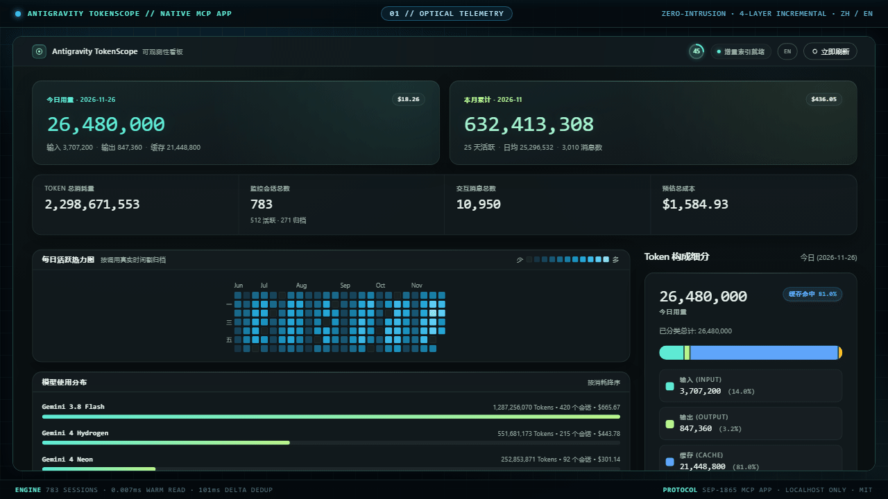

<div align="center">


# Antigravity TokenScope

**原生运行在 Antigravity 内的 Token 与成本可观测性插件 —— 零重复核算、零云端上传、无需切换 VS Code。**

[](https://antigravity.google/)
[](https://github.com/modelcontextprotocol/ext-apps)
[](https://svelte.dev/)
[](#-隐私声明与免责)
[](../LICENSE)

[English](../README.md) | **简体中文**

</div>

---



## 为什么选择 Antigravity TokenScope？

您是否一直想知道自己的 Antigravity Agent **今天**或**本月**到底消耗了多少 Token 和费用——却不想每次都打开笨重的 VS Code、不想被 Subagent 克隆记录导致的 2~5 倍虚高账单误导、更不想把本地对话隐私上传到任何第三方服务器？

**Antigravity TokenScope** 以 **Antigravity 原生插件（MCP App）** 形态深度集成在您的日常工作流中（同时继续以维护模式兼容原 VS Code 扩展），将本地会话日志、SQLite `.db` 数据库与回环 RPC 元数据实时转化为精准、美观、自适应明暗主题的可观测性面板。

| 对比维度 | Antigravity TokenScope（官方原生内置插件） | 非官方注入 / 外部统计脚本 |
| :--- | :--- | :--- |
| **官方内置零侵入优势** | 100% 遵循 Antigravity 官方插件与 MCP App 规范，**无需开启 `--remote-debugging-port`、不做任何非官方 DOM 注入**，随客户端升级稳定不失效 | 依赖调试端口与前端 DOM 注入，易随宿主改版失效且存在端口暴露风险 |
| **原生交互体验** | 直接内置于 Antigravity 左侧全局栏、右侧辅助栏与对话查询，支持一键中/英双语切换 | 必须切回 VS Code、手动敲命令或依赖脆弱浮层 |
| **核算精准度** | 深度思考与纯输出正交拆分、`responseId` 跨会话仲裁、撤回分支融合 | 重复累加思考 Token、重试镜像与 Subagent 克隆（虚高 2~5 倍） |
| **本月与今日洞察** | **今日用量 + 本月累计**双光学主卡、**10 档渐进热力图**、真实本地日历分模型计费 | 跨日会话归属错乱、按历史均价分摊造成单日费用失真 |
| **4 层增量引擎** | 持久化局部去重索引 + 内存版本缓存（热打开 `< 1ms`，780+ 会话单次增量仅 `~100ms`） | 每次打开重复全量扫描全盘历史，越用越慢 |
| **隐私安全** | 100% 本地扫描分析，严格限制仅本机 `127.0.0.1` 回环 RPC，零遥测 | 依赖外部代理、云端同步或开放调试端口 |

---

## 三种原生使用方式

1. **左侧全局全页大屏（`TokenScope`）**
   在 Antigravity 左侧导航栏一键打开完整 Svelte 5 可观测性看板：涵盖**本月累计 KPI**、**当日 Token 构成细分**（Input / Output / Cache / Reasoning）、交互式**每日活跃热力图**、**模型分布与 LiteLLM 费用估算**、数据源覆盖率以及会话排行榜，自动适配浅色与深色主题。
2. **右侧辅助栏常驻面板（`Token 用量`）**
   从右侧栏 `+` 菜单打开精简面板，首屏突出显示**本月累计 Token / 估算费用**、**今日消耗**与**当日构成细分**，方便边聊边看。
3. **对话内直接询问（内置 Skill）**
   直接在对话里问“今天用了多少 token”或“本月累计消耗多少”，内置 `token-monitor` 技能会自动汇总今日、本月与全量数据。

---

## 60 秒快速开始（Antigravity 原生插件）

### 环境要求

- 本机已安装并运行 [Antigravity](https://antigravity.google/)（或 `~/.gemini/antigravity` 下有历史会话）
- [Node.js](https://nodejs.org/) `≥ 22`（提供内置 `node:sqlite` 支持本地 `.db` 直读；Node 20+ 会自动降级回 RPC 与文件系统解析）

### 3 步源码构建与一键接入

```bash
git clone https://github.com/215meng/antigravity-tokenscope.git
cd antigravity-tokenscope
npm install && npm run build:plugin && npm run install:plugin
```

`install:plugin` 会自动将单文件自包含前端（`< 800 KiB`）与 `stdio` MCP Server 安装到 `~/.gemini/config/plugins/antigravity-token-monitor/`，并向运行中的 Antigravity 触发热刷新，立即可用。

> [!TIP]
> 如果您此前手动安装过旧版散装技能 `~/.gemini/config/skills/token-monitor/`，升级到 TokenScope 原生插件后可手动删除该旧目录，避免重复触发。

---

## 核心技术与项目架构

```text
Core (纯配置/周期汇总) → Storage → Acquisition (回环直连/进程探测/SQLite) → Analysis (精确去重/计价) → Orchestration → Presentation (MCP App / VS Code)
```

- **全链路精确去重引擎**：优先解析权威 `raw.chatModel.usage`，屏蔽顶层翻倍脏字段与 `retryInfos` 镜像；正交拆分 `responseOutputTokens` 与 `thinkingOutputTokens`；基于 `responseId` 执行跨会话所有权仲裁消除 Subagent 虚高；自动融合 `transcript.jsonl` 中的撤回/重发分支。
- **真实逐日分模型计费**：提取 SQLite `steps` 时间戳与 `created_at`，将每次模型调用精准归入真实发生日期并按当日模型构成独立估算费用。
- **模块结构**：
  - `src/core/` — 无宿主依赖的纯配置、通用接口抽象与今日/本月/全量汇总器
  - `src/mcp/` — Antigravity MCP App `stdio` 服务端（SEP-1865 + `com.google.antigravity/ui`）、回环安全校验直连器与体积受控的自包含工具处理器
  - `src/rpc/` — 跨平台进程探测、HTTP/HTTPS 本地 RPC 客户端、`node:sqlite` 直读与增量导出
  - `src/parser/` & `src/monitor/` — 规范化解析、跨会话去重、文件锁与非阻塞轮询编排
  - `src/pricing/` — LiteLLM 价格表同步与模型别名解析（支持 Gemini 4 系列、Gemini 3.8、Claude 5.5 / 4.6、GPT-OSS 等）
  - `src/webview/` — 双模 Svelte 5 前端（`HostBridge` + `ThemeBridge`，同时服务 Antigravity MCP App 与 VS Code）
  - `plugin-template/` & `scripts/` — 已脱敏的开源插件模板、单文件打包与跨平台一键安装脚本

---

## VS Code 扩展（维护模式）

原 VS Code 扩展与 Antigravity 原生插件共享同一套核心引擎与 Svelte 5 组件。如需打包 VSIX：

```bash
npm run typecheck && npm run typecheck:webview && npm run test:webview && npm run package
```

Windows 用户也可直接运行根目录的 `.\install-extension.ps1`，或在 VS Code 中执行 `Extensions: Install from VSIX...`。

---

## 隐私声明与免责

- **100% 本地运算**：所有会话扫描、数据库读取与统计分析均在本地完成，绝不上传对话内容或隐私数据；仅向 GitHub 拉取公开的 [LiteLLM 模型定价 JSON](https://github.com/BerriAI/litellm)；直连环境变量强制限制仅允许回环地址（`127.0.0.1` / `localhost` / `::1`）。
- **非官方社区工具**：与 Google 无关；依赖 Antigravity 本地持久化数据与内部 RPC 接口；估算费用仅供参考，不作财务结算依据。

---

## 致谢与上游声明（Upstream Attribution）

**Antigravity TokenScope** 起源于对开源项目 **[ddarkr/antigravity-token-monitor](https://github.com/ddarkr/antigravity-token-monitor)**（MIT License）的深度重构与演进，现已发展为原生的 Antigravity MCP App 可观测性插件，完整保留原作者版权声明并致以敬意：

- **[ddarkr/antigravity-token-monitor](https://github.com/ddarkr/antigravity-token-monitor)** — 原作者与基础项目
- **[antigravity-storage-manager](https://github.com/unchase/antigravity-storage-manager)** — 会话 Token 解析思路参考
- **[tokscale](https://github.com/junhoyeo/tokscale)** — 用量追踪与可视化灵感

## License

MIT License — 详见 [LICENSE](../LICENSE)。如果 **Antigravity TokenScope** 帮您省下了频繁切窗口的时间或揪出了隐形 Token 消耗，欢迎在 GitHub 点一颗 ⭐ Star 支持！
